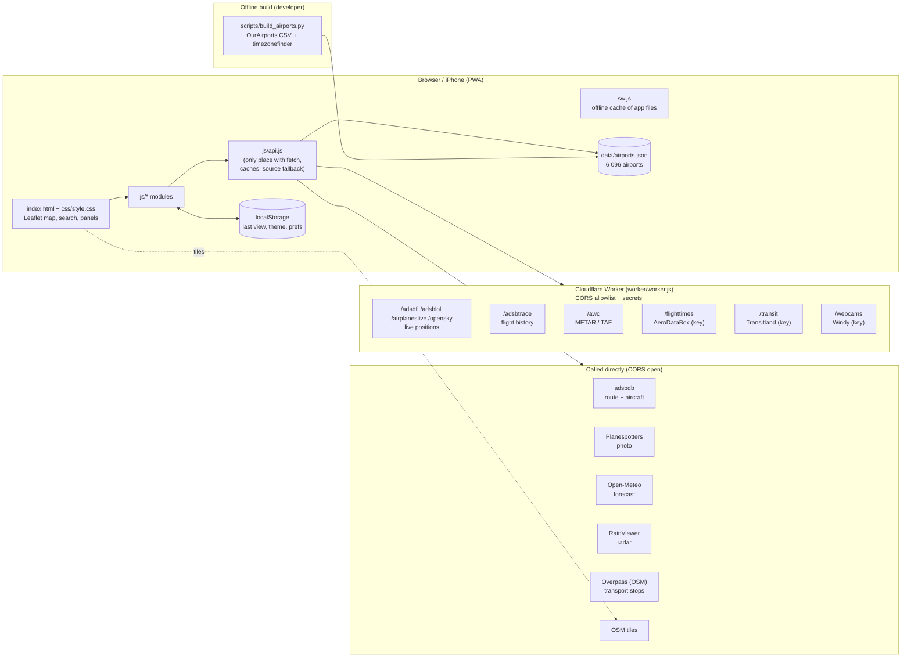
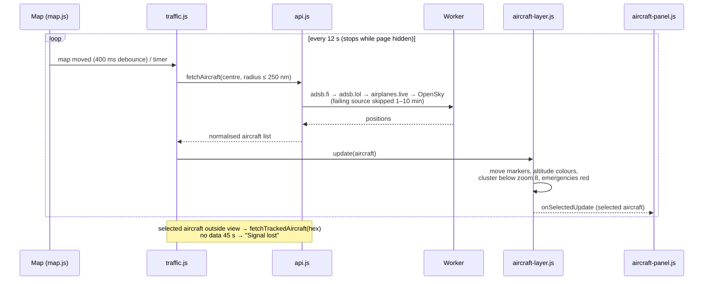
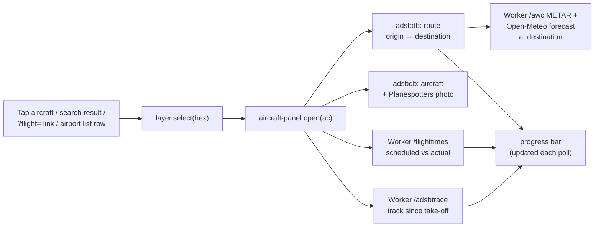
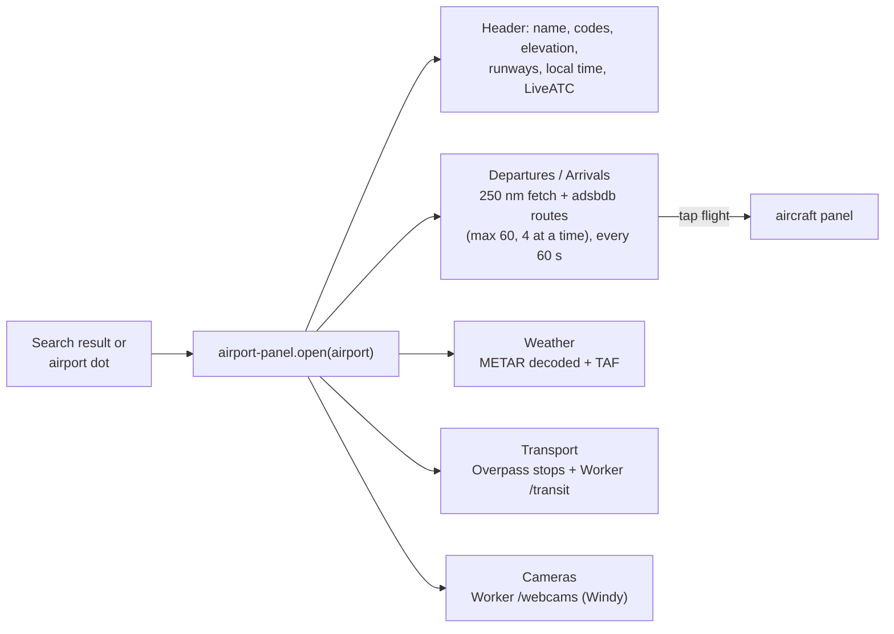

# How Flights works

A static PWA on GitHub Pages. Everything runs in the browser; the only server-side piece is a small
Cloudflare Worker that proxies sources blocked by CORS and holds API keys. All network calls go through `js/api.js`.

## 1. Big picture

## 2. Module map

```mermaid
flowchart TD
  MAIN["main.js<br/>entry, wires everything"]

  MAIN --> MAP["map.js<br/>Leaflet map, last view"]
  MAIN --> THEME["theme.js<br/>Auto / Dark / Light"]
  MAIN --> LEG["altitude.js<br/>colour scale + legend"]
  MAIN --> TRAFFIC["traffic.js<br/>poll 12 s, viewport circle,<br/>pause when hidden"]
  MAIN --> LAYER["aircraft-layer.js<br/>markers by hex, clusters,<br/>emergencies, selection"]
  MAIN --> ALERTS["alerts.js<br/>7500/7600/7700 chips"]
  MAIN --> SHARE["share.js<br/>?flight= links"]
  MAIN --> REFRESH["refresh.js<br/>refresh button, 'Updated Xs ago'"]
  MAIN --> LAYERS["layers.js<br/>radar, day/night"]
  MAIN --> SEARCH["search.js<br/>flights + airports"]
  MAIN --> APL["airport-layer.js<br/>airport dots"]
  MAIN --> ACP["aircraft-panel.js"]
  MAIN --> ARP["airport-panel.js"]

  LAYER --> GLIDE["glide.js<br/>smooth movement"]
  LAYER --> ICON["plane-icon.js"]
  SEARCH --> AIRL["airlines.js<br/>IATA ↔ ICAO"]

  ACP --> TRACK["track.js<br/>history + dashed great circle"]
  ACP --> PB["progress-bar.js → progress.js<br/>flown / remaining / ETA"]
  ACP --> FT["flight-times.js<br/>scheduled vs actual"]
  ACP --> METAR["metar.js<br/>decode + flight category"]
  ACP --> FC["forecast.js"]
  ACP --> ATC["atc.js<br/>LiveATC links"]

  ARP --> ATR["airport-traffic.js<br/>derived departures / arrivals"]
  ARP --> METAR
  ARP --> TR["transport.js<br/>stops + departures"]
  ARP --> CAM["webcams.js"]
  ARP --> LT["localtime.js"]
  ARP --> ATC

  ACP & ARP --> PANEL["panel.js<br/>shared side panel / bottom sheet"]
  TRAFFIC & SEARCH & REFRESH --> STATUS["status.js<br/>messages under search bar"]

  TRAFFIC & SEARCH & ACP & ARP & TRACK & LAYERS & CAM & ATR --> API["api.js"]
```

## 3. Live-position loop

## 4. Opening an aircraft

## 5. Opening an airport

## Caching summary

| What | Where | How long |
|---|---|---|
| App files | `sw.js` | network-first, cache as offline fallback |
| Route, aircraft, photo | `api.js` | session |
| METAR / TAF | `api.js` | 5 min |
| Forecast, flight times | `api.js` (+ Worker KV for times) | 15 min |
| Transit departures | `api.js` / Worker | 60 s / 2 min |
| Webcams | `api.js` | 10 min |
| Last map view, theme | `localStorage` | permanent |
